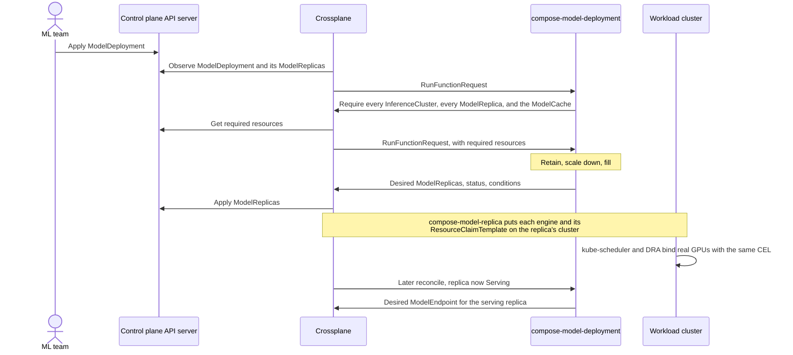

# The fleet scheduler

Modelplane's fleet scheduler is the `compose-model-deployment` composition
function. It decides which cluster, and which GPU pool on that cluster, runs
each replica of a ModelDeployment. It's a pure function of observed state. On
every reconcile it reads the deployment along with every InferenceCluster and
ModelReplica in the control plane, then recomputes the whole placement. The
same state always produces the same placement.

The source is in Modelplane's
[`scheduling.py`](https://github.com/modelplaneai/modelplane/blob/baad7e3f5c6f3595db898fc964f78df6a4c134a1/functions/compose-model-deployment/function/scheduling.py)
and [`fn.py`](https://github.com/modelplaneai/modelplane/blob/baad7e3f5c6f3595db898fc964f78df6a4c134a1/functions/compose-model-deployment/function/fn.py).

## Inputs

The function asks Crossplane for three things through `require_resources`:

- **InferenceClusters.** Every one, unless the deployment has a
  `clusterSelector` or references a ModelCache with one, in which case only
  the clusters matching both. Each cluster publishes its GPU pools in
  `status.gpuPools`: the devices it copied from the pool's InferenceClass, and
  a node count from the pool's `maxNodeCount` or `nodeCount`. That's declared
  capacity, so the scheduler can place onto nodes that don't exist yet.
- **ModelReplicas.** Every one, from every deployment, so it can subtract
  capacity other deployments already use. A require with no selector meaning
  "all of this kind" was one of the upstream fixes.
- **The ModelCache**, if the deployment references one. Clusters without cache
  storage drop out of the candidates. Until Crossplane returns the cache, the
  scheduler keeps existing replicas but doesn't place new ones.

Since Crossplane v2.4, a change to any of these reconciles the deployment
straight away, rather than at the next poll.

## Scheduling

Scheduling runs in three phases.

1. **Retain.** Keep each existing replica where it is if its cluster still
   exists, its pinned pool still matches the deployment's CEL, and the cluster
   has no NoExecute taint the deployment doesn't tolerate. A cluster that's
   merely unhealthy still keeps its replicas. Existing placements are inputs,
   not decisions. The scheduler never moves a replica to improve the overall
   placement.
2. **Scale down.** If retain kept more replicas than desired, drop them one at
   a time from whichever cluster has the most, highest index first.
3. **Fill.** If retain kept fewer replicas than desired, place the rest one at
   a time. Each new replica goes to the eligible cluster with the fewest of this
   deployment's replicas, with ties broken by cluster name. That spreads first
   and packs only when capacity forces it. `pack-first.patch` flips that sort
   key.

A cluster is eligible for a new replica when it's Ready, its gateway has a
hostname, it has no NoSchedule or NoExecute taint the deployment doesn't
tolerate, and every engine in the replica fits on one of its pools.

A replica never moves. Draining a cluster drops its replicas from the retained
set, Crossplane deletes them, and fill places replacements elsewhere: delete
plus create, like a Pod whose node disappears.

## Matching

An engine fits a pool when every member's CEL selectors match a device in the
pool's declared devices, and the pool has enough free nodes for the whole
engine. All members of an engine go on one pool, because pool status doesn't
say whether two pools share an interconnect and a multi-node engine split
across fabrics would hang.

The CEL is the DRA device-selector dialect, evaluated in Python. `cel.py`
reimplements Kubernetes' DRA CEL environment on the celpy library, including
`quantity()` and `semver()`. The function's tests pin answers taken from
running the real Kubernetes Go code. The scheduler then writes the same CEL
into each replica's device requests, so DRA on the workload cluster checks it
again against real GPUs.

## Capacity

The scheduler counts capacity in whole nodes per pool, not individual devices.
Its ledger starts from each pool's published node count and subtracts the
nodes used by other deployments' replicas and this deployment's retained
replicas. Fill subtracts from the ledger as it places each replica, so one pass
can't overcommit a pool. Both matching and placement are greedy, without
backtracking. That can reject a placement that would have fit, but can't
overcommit.

## Likely questions

- **What if two deployments schedule concurrently?** Each schedules
  independently, so both can count the same free nodes. The workload
  cluster's scheduler settles contention between deployments when it
  allocates devices through DRA. A pod whose claim
  DRA can't satisfy stays Pending, and the next reconcile reads the updated
  state.
- **Why not schedule against real ResourceSlices?** They only exist for nodes
  that exist. The fleet scheduler places against declared pool capacity,
  including autoscaled pools at zero, and leaves binding real devices to DRA.
- **What happens when nothing fits?** The deployment's `ReplicasScheduled`
  condition goes False with reason `InsufficientCapacity`, and it places
  replicas as capacity appears.
- **What happens when a cluster joins?** Existing replicas don't move. Fill
  considers the new cluster for new or replacement replicas.
- **When does traffic reach a replica?** The function composes a replica's
  ModelEndpoint only once the replica reports Serving. The gateway never
  routes to an engine still loading weights.
